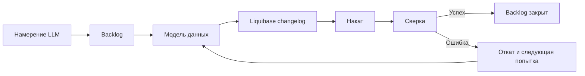

# Начальные бизнес-требования Liquibase Forge

Документ фиксирует согласованные бизнес-требования первой поставки Liquibase Forge. Решения,
которые ещё не приняты, вынесены в отдельный раздел и не считаются требованиями поставки.

---

## Навигация

- [Контекст и цель](#контекст-и-цель)
- [Термины](#термины)
- [Бизнес-сценарий](#бизнес-сценарий)
- [Требования первой поставки](#требования-первой-поставки)
- [Границы первой поставки](#границы-первой-поставки)
- [Критерии результата](#критерии-результата)
- [Открытые решения](#открытые-решения)
- [Версионирование](#версионирование)

---

## Контекст и цель

Во многих проектах требуется создавать и поддерживать модели данных. Ручная подготовка
миграций требует от LLM знания синтаксиса мигратора и ручного контроля их применения.

Цель первой поставки — дать LLM возможность по намерению построить и подтвердить модель
данных PostgreSQL без ручного написания changelog или ручного запуска миграционных команд.

## Термины

Большая языковая модель (Large Language Model, LLM) — пользователь Liquibase Forge,
вызывающий его посредством навыка.

Модель данных (Data Model) — описание структуры данных в собственном формате Liquibase Forge.
Формат не привязан к PostgreSQL.

Backlog — носитель намерения, последовательности операций, стоп-знаков, попыток и результатов.

Changelog — миграция Liquibase, полученная из модели данных для её применения к целевой БД.

## Бизнес-сценарий

LLM передаёт текстовое намерение. Liquibase Forge создаёт backlog, в котором модель данных
преобразуется в changelog, накатывается на PostgreSQL и сверяется с фактической схемой БД.

Backlog допускает не более трёх попыток. При неуспешной сверке текущая попытка откатывается,
модель корректируется, и начинается следующая попытка.

## Требования первой поставки

### Управление намерением и backlog

- **BR-001.** Liquibase Forge должен принимать от LLM текстовое намерение на изменение модели данных.
- **BR-002.** Liquibase Forge должен создавать backlog до создания модели данных.
- **BR-003.** Backlog должен хранить исходное намерение, модели данных, changelog, результаты наката,
  сверки и отката каждой попытки.
- **BR-004.** В backlog должно быть не более трёх попыток достижения подтверждённой модели данных.

### Стоп-знаки

- **BR-005.** Backlog должен использовать стоп-знаки плагина `formular` перед созданием модели данных.
- **BR-006.** Backlog должен использовать стоп-знак перед накатом подготовленного changelog.
- **BR-007.** Backlog должен использовать стоп-знак перед закрытием успешно сверенного backlog.

### Построение и применение модели

- **BR-008.** Liquibase Forge должен создавать модель данных в собственном формате, независимом от PostgreSQL.
- **BR-009.** Liquibase Forge должен преобразовывать модель данных в changelog Liquibase для PostgreSQL.
- **BR-010.** Liquibase Forge не должен использовать Liquibase AI Changelog Generator MCP.
- **BR-011.** При неуспешной сверке Liquibase Forge должен откатывать накат текущей попытки до
  корректировки модели и следующей попытки.

### Сверка и результат

- **BR-012.** Сверка должна подтверждать соответствие фактической схемы PostgreSQL модели данных
  и наличие записи о применённом changelog в Liquibase.
- **BR-013.** При успешной сверке Liquibase Forge должен закрывать backlog как выполненный.
- **BR-014.** Liquibase Forge должен возвращать LLM итог операции: статус, число попыток, ссылки
  на модель и changelog, а также результаты сверки.
- **BR-015.** При неуспешном результате итог операции должен содержать сведения, достаточные для
  разбора причины и улучшения следующего решения.

## Границы первой поставки

- Поддерживаемая СУБД — PostgreSQL. Независимость формата модели данных не означает поддержки
  других СУБД в первой поставке.
- Работа допускается только с локальной или тестовой БД; production БД не входит в поставку.
- Исходная БД должна быть пустой либо её схема должна полностью управляться Liquibase.
- Разрешены только добавляющие изменения схемы. Удаление и переименование таблиц, полей и
  ограничений, а также преобразование данных не входят в первую поставку.

## Критерии результата

Первая поставка считается успешной, если LLM одним вызовом навыка может получить подтверждённую
модель PostgreSQL без ручного написания changelog и без ручного выполнения миграционных команд.

Подтверждённый результат содержит:

- фактическую схему PostgreSQL, соответствующую модели данных;
- запись Liquibase о применённом changelog;
- закрытый backlog со следом всех выполненных попыток;
- итоговый отчёт для LLM.

## Открытые решения

- Семантика и полный состав собственного формата модели данных.
- Кто и каким действием подтверждает стоп-знаки `formular`.
- Состояние backlog после третьей неуспешной попытки: закрыт с ошибкой или остаётся открытым.
- Формат и место хранения ссылок на модель, changelog и результаты операций.

## Версионирование

| Версия | Дата | Задача | Агент | Модель | Описание изменений |
|--------|------|--------|-------|--------|--------------------|
| 0.1.0 | 2026-10-16 | Запрос пользователя: зафиксировать начальные бизнес-требования Liquibase Forge | Codex | GPT-6 | Создан документ с согласованным сценарием LLM → backlog → модель данных → changelog → накат → сверка, тремя попытками, стоп-знаками formular, границами первой поставки и критериями результата |
