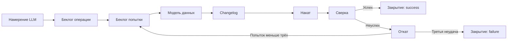

# Начальные бизнес-требования Liquibase Forge

Документ фиксирует согласованные бизнес-требования первой поставки Liquibase Forge. Решения,
которые ещё не приняты, вынесены в отдельный раздел и не считаются требованиями поставки.

---

## Навигация

- [Контекст и цель](#контекст-и-цель)
- [Термины](#термины)
- [Бизнес-сценарий](#бизнес-сценарий)
- [Требования первой поставки](#требования-первой-поставки)
- [Границы первой поставки](#границы-первой-поставки)
- [Критерии результата](#критерии-результата)
- [Открытые решения](#открытые-решения)
- [Версионирование](#версионирование)

---

## Контекст и цель

Во многих проектах требуется создавать и поддерживать модели данных. Ручная подготовка
миграций требует от большой языковой модели (Large Language Model, LLM) знания синтаксиса
мигратора и ручного контроля их применения.

Цель первой поставки — дать LLM возможность по намерению построить и подтвердить модель
данных PostgreSQL без ручного написания changelog или ручного запуска миграционных команд.

## Термины

Понятия проекта — намерение, модель данных, попытка, changelog, накат, откат, сверка, режим
операции, автоматический гейт и другие — определены в [domain.md](./docs/domain.md). Понятия
беклога (беклог операции, шаблон операции, стоп-знак) принадлежат плагину `formular`
и используются без переопределения.

Ключевое для требований: LLM — пользователь Liquibase Forge, вызывающий его посредством навыка;
модель данных описывает целевое состояние схемы в собственном формате, не привязанном
к PostgreSQL.

## Бизнес-сценарий

LLM передаёт текстовое намерение. Liquibase Forge порождает беклог операции, а каждая попытка
исполняется отдельным беклогом попытки: модель данных преобразуется в changelog, накатывается
на PostgreSQL и сверяется с фактической схемой БД.

Операция допускает не более трёх попыток. При неуспешной сверке накат попытки откатывается,
модель корректируется, и начинается следующая попытка. Устройство операции описано
в [architecture.md](./docs/architecture.md).

## Требования первой поставки

### Управление намерением и беклогом

- **BR-001.** Liquibase Forge должен принимать от LLM текстовое намерение на изменение модели данных.
- **BR-002.** Liquibase Forge должен создавать беклог операции до создания модели данных.
- **BR-003.** Беклог операции должен хранить исходное намерение, режим, перечень беклогов попыток,
  ссылки на модель, changelog и результаты наката, сверки и отката каждой попытки, вердикты попыток
  и статус операции. Каждая попытка исполняется отдельным беклогом попытки.
- **BR-004.** В операции должно быть не более трёх попыток достижения подтверждённой модели данных.

### Стоп-знаки

- **BR-005.** Беклог попытки должен использовать стоп-знак плагина `formular` перед созданием
  модели данных в каждой попытке.
- **BR-006.** Беклог попытки должен использовать стоп-знак перед накатом подготовленного changelog.
- **BR-007.** Беклог операции должен использовать стоп-знак перед закрытием операции.

### Построение и применение модели

- **BR-008.** Liquibase Forge должен создавать модель данных в собственном формате, независимом от PostgreSQL.
- **BR-009.** Liquibase Forge должен преобразовывать модель данных в changelog Liquibase для PostgreSQL.
- **BR-010.** Liquibase Forge не должен использовать Liquibase AI Changelog Generator MCP.
- **BR-011.** При неуспешной сверке беклог операции должен откатывать накат текущей попытки
  до корректировки модели и следующей попытки; откат подтверждается проверкой возврата схемы.

### Сверка и результат

- **BR-012.** Сверка должна подтверждать соответствие фактической схемы PostgreSQL модели данных
  и наличие записи о применённом changelog в Liquibase.
- **BR-013.** При успешной сверке Liquibase Forge должен закрывать операцию со статусом `success`
  и принимать модель и changelog в состояние проекта.
- **BR-014.** Liquibase Forge должен возвращать LLM итог операции: статус, число попыток, ссылки
  на модель и changelog, а также результаты сверки.
- **BR-015.** При неуспешном результате итог операции должен содержать сведения, достаточные для
  разбора причины и улучшения следующего решения.

### Режимы и исходы операции

- **BR-016.** Liquibase Forge должен поддерживать режимы операции `interactive` (по умолчанию)
  и `auto`. В режиме `auto` стоп-знаки BR-005..BR-007 заменены автоматическими гейтами
  с машинно проверяемыми условиями; режим `auto` допустим только для тестовой БД.
- **BR-017.** Отказ владельца на стоп-знаке должен приостанавливать операцию без расхода попытки;
  повторный вызов продолжает операцию с прерванной задачи.
- **BR-018.** После третьей неуспешной попытки Liquibase Forge должен откатить её накат и закрыть
  операцию со статусом `failure`, не изменяя принятое состояние проекта.

## Границы первой поставки

- Поддерживаемая СУБД — PostgreSQL. Независимость формата модели данных не означает поддержки
  других СУБД в первой поставке.
- Работа допускается только с локальной или тестовой БД; production БД не входит в поставку.
- Исходная БД должна быть пустой либо её схема должна полностью управляться Liquibase.
- Разрешены добавление и удаление таблиц, полей и ограничений. Переименование выражается
  удалением с добавлением; в режиме `auto` удаление таблиц и полей требует согласия операции.
  Смена типа, допустимости NULL и первичного ключа, а также преобразование и сохранение данных
  удаляемых объектов в поставку не входят — см. [migration.md](./docs/migration.md#неподдерживаемые-изменения).

## Критерии результата

Первая поставка считается успешной, если LLM одним вызовом навыка может получить подтверждённую
модель PostgreSQL без ручного написания changelog и без ручного выполнения миграционных команд.
В режиме `interactive` участие человека сводится к подтверждению стоп-знаков; в режиме `auto`
участие человека не требуется.

Подтверждённый результат содержит:

- фактическую схему PostgreSQL, соответствующую модели данных;
- запись Liquibase о применённом changelog;
- завершённый беклог операции и беклоги попыток со следом всех выполненных попыток;
- итоговый отчёт для LLM.

## Открытые решения

Открытых решений нет.

Закрытые решения:

- Семантика и состав собственного формата модели данных — YAML-файл версии `1` на первом срезе
  ядра, см. [model-format.md](./docs/model-format.md); понятия ядра перечислены
  в [domain.md](./docs/domain.md#ядро-модели-данных).
- Кто подтверждает стоп-знаки — владелец в режиме `interactive`; в режиме `auto` их место
  занимают автоматические гейты (BR-016).
- Состояние после третьей неуспешной попытки — операция закрыта со статусом `failure`, беклог
  завершён (BR-018).
- Формат и место хранения ссылок — фронтматтер беклога операции и след
  `backlog/forge-model/<штамп>/`, см. [architecture.md](./docs/architecture.md#раскладка-следа-и-принятого-состояния).

## Версионирование

| Версия | Дата | Задача | Агент | Модель | Описание изменений |
|--------|------|--------|-------|--------|--------------------|
| 0.1.0 | 2026-10-16 | Запрос пользователя: зафиксировать начальные бизнес-требования Liquibase Forge | Codex | GPT-6 | Создан документ с согласованным сценарием LLM → backlog → модель данных → changelog → накат → сверка, тремя попытками, стоп-знаками formular, границами первой поставки и критериями результата |
| 0.2.0 | 2026-10-16 | OpenSpec change `design-foundation` | Claude Code | Claude Opus 5.5 | Термины перенесены в `docs/domain.md` (в разделе — резюме и ссылка); сценарий перерисован под беклог операции и беклоги попыток; переформулированы BR-002, BR-003, BR-005..BR-007, BR-011, BR-013; добавлены BR-016 (режимы `interactive` и `auto`), BR-017 (отказ как пауза), BR-018 (исход после третьей неудачи); критерий результата уточнён участием человека по режимам; открытые решения №2–4 закрыты ссылками, №1 оставлено до этапа 2. Номера BR-001..BR-015 сохранены |
| 0.2.1 | 2026-10-18 | OpenSpec change `forge-model-format` | Claude Code | Claude Opus 5.5 | Открытое решение о семантике и составе формата модели данных перенесено в закрытые со ссылкой на `docs/model-format.md`; раздел «Открытые решения» фиксирует, что открытых решений нет |
| 0.3.0 | 2026-10-23 | LBFR-018, OpenSpec change `prepare-release-0-2-0` | Claude Code | Claude Opus 5.5 | Границы поставки приведены к действующему поведению: вместо «только добавляющие изменения» — добавление и удаление таблиц, полей и ограничений, переименование как удаление с добавлением, согласие операции на удаления в `auto`; смена типа, NULL и первичного ключа, преобразование и сохранение данных удаляемых объектов — вне поставки, со ссылкой на `docs/migration.md`. Номера BR не изменились |
