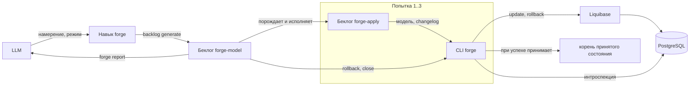
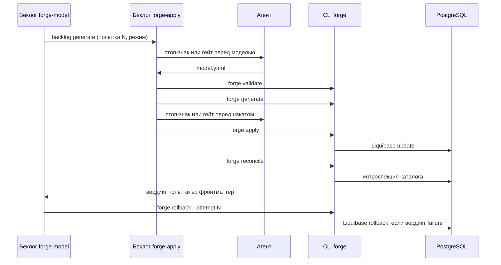
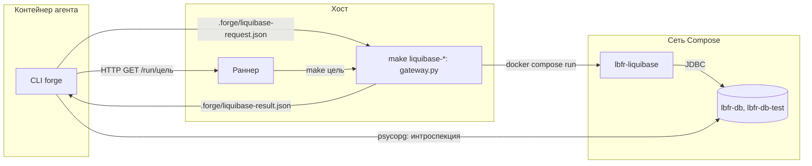

# Архитектура Liquibase Forge

Как работает система от намерения LLM до итогового отчёта: компоненты, поток операции,
последовательность одной попытки, контракт команд CLI `forge` и раскладка следа.
Понятия определены в [domain.md](./domain.md).

---

## Навигация

- [Принцип разделения](#принцип-разделения)
- [Компоненты](#компоненты)
- [Поток операции](#поток-операции)
- [Последовательность попытки](#последовательность-попытки)
- [Контракт команд CLI](#контракт-команд-cli)
- [Раскладка следа и принятого состояния](#раскладка-следа-и-принятого-состояния)
- [Окружение исполнения](#окружение-исполнения)
- [Ограничения и риски](#ограничения-и-риски)
- [Версионирование](#версионирование)

---

## Принцип разделения

- **Агент думает:** толкует намерение, пишет модель данных, правит её по расхождениям.
- **CLI исполняет:** проверка модели, построение changelog, накат, сверка, откат, закрытие,
  отчёт — детерминированно и проверяемо тестами.
- **Беклог задаёт порядок:** шаблоны `formular` фиксируют последовательность, стоп-знаки
  и лимит попыток. Ветвления по ходу исполнения в беклоге нет: задачи сформулированы как цели,
  а развилку по фронтматтеру решает команда CLI.

---

## Компоненты

| Компонент | Контекст | Роль |
|-----------|----------|------|
| Навык `forge` | Операция | Принимает намерение и режим, порождает беклог операции, передаёт его исполнителю беклога |
| Беклог `forge-model` | Операция | Журнал операции: три группы «попытка и откат», закрытие, отчёт |
| Беклог `forge-apply` | Операция | Одна попытка: модель, проверка, changelog, накат, сверка |
| Агент | Операция, Моделирование | Исполняет беклоги через `/backlog:backlog-run`, пишет модель данных |
| CLI `forge` | Моделирование, Миграция, Сверка, Операция | Детерминированные шаги и развилки |
| Liquibase | Миграция | Накат и откат changelog, журнал `DATABASECHANGELOG` |
| Раннер | Миграция | Исполняет на хосте цели `make` из белого списка по HTTP-запросу агента: так агент без Docker запускает Liquibase |
| `lbfr-liquibase` | Миграция | Одноразовый контейнер Liquibase 5.x с драйвером PostgreSQL, проект смонтирован только на чтение |
| PostgreSQL | — | Тестовая целевая БД в Docker Compose (`lbfr-db`) и сервер БД интеграционных тестов (`lbfr-db-test`) |

---

## Поток операции



1. LLM вызывает навык `forge` с намерением и режимом.
1. Навык порождает беклог операции и передаёт его исполнителю `/backlog:backlog-run`.
1. Каждая группа попытки порождает беклог `forge-apply` и исполняет его до вердикта сверки.
1. Задача отката вызывает `forge rollback`: после успеха ничего не меняет, после неуспеха
   возвращает схему к состоянию до попытки.
1. Группы следующих попыток пропускаются, если модель уже подтверждена.
1. Закрытие под стоп-знаком или гейтом: `forge close` при успехе принимает модель и changelog
   в корень принятого состояния, после трёх неудач ставит `failure`.
1. `backlog verify` подтверждает полноту исполнения, `forge report` возвращает отчёт LLM.

---

## Последовательность попытки



Перед моделью стоп-знак попытки 1 показывает понимание намерения, попыток 2–3 — расхождения
предыдущей попытки и план правки. Перед накатом показываются changelog и адрес целевой БД.

---

## Контракт команд CLI

Каждая команда печатает в стандартный вывод ровно один JSON-объект; диагностика — только
в стандартный поток ошибок. Коды возврата: `0` — успех, `1` — неуспех операции, `2` — ошибка
вызова или окружения. Пути — относительные от корня проекта.

| Команда | Вход | Выход | `1` при |
|---------|------|-------|---------|
| `forge status` | беклог операции либо `--latest`, параметры среды из окружения | статус операции, вердикты попыток, номер подтверждённой попытки, проверки среды | — (сбой среды — `2`) |
| `forge validate` | файл модели | перечень нарушений модели с путями | модель некорректна |
| `forge generate` | модель попытки, принятая модель (по умолчанию — из корня принятого состояния; нет файла — пустая), беклог операции (штамп), путь changelog | путь changelog и перечень changeset | модель некорректна или требует неаддитивных изменений |
| `forge apply` | changelog, параметры БД из окружения | `apply.json` рядом с changelog: результат Liquibase | ошибка Liquibase |
| `forge reconcile` | модель, changelog, параметры БД из окружения | `reconcile.json` рядом с changelog: вердикт и перечень расхождений | есть расхождения |
| `forge rollback` | беклог операции, номер попытки | `rollback.json` в каталоге попытки: что откатано и проверка возврата | возврат схемы не подтверждён |
| `forge stop` | беклог операции, причина | статус `stopped` и причина во фронтматтере | операция закрыта |
| `forge resume` | беклог операции | статус `running` | операция не остановлена |
| `forge close` | беклог операции | статус операции; при `success` — пути в корне принятого состояния | закрывать рано: нет подтверждённой попытки и трёх неудач с подтверждённым откатом |
| `forge report` | беклог операции | итоговый отчёт для LLM | статус операции `failure` |

Целевая БД вне перечня тестовых, недоступный раннер или отказ шлюза — код `2`: это ошибка
окружения, а не неуспех попытки, и попытка на ней не расходуется. Подробности наката и отката —
в [migration.md](./migration.md), сверки — в [reconciliation.md](./reconciliation.md),
статусов, закрытия и отчёта — в [operation.md](./operation.md).

`forge rollback` после успешной сверки попытки ничего не меняет и возвращает `0`. Иначе он
откатывает фактически применённые changeset попытки. Если Liquibase rollback не удался или записи
попытки не являются хвостом журнала, команда пересоздаёт тестовую БД и накатывает принятый
`master.yaml` корня принятого состояния.

---

## Раскладка следа и принятого состояния

```text
backlog/                         след: в целевом проекте коммитится, в репозитории разработки — нет
├── forge-model/<штамп>/
│   ├── tasks.md                 беклог операции и журнал
│   └── attempt-N/
│       ├── model.yaml
│       ├── changelog.yaml
│       ├── apply.json
│       ├── reconcile.json
│       └── rollback.json
└── forge-apply/<штамп>-<N>/
    └── tasks.md                 беклог попытки N
db/                              принятое состояние, коммитится; корень — FORGE_ACCEPTED_DIR
├── model.yaml
└── changelog/
```

След закрытой операции коммитится в целевом проекте вместе с принятым состоянием: `forge report`
называет каталог операции и каталоги беклогов попыток в `commit.files`. В репозитории разработки
след исключён строкой `backlog/*` в `.gitignore`. Корень следа — `backlog/`: шаблоны называют
его литералом, и `BACKLOG_ROOT` для операций forge не поддерживается.

Корень принятого состояния задаёт `FORGE_ACCEPTED_DIR`, умолчание — `db`. В репозитории
разработки Liquibase Forge он равен `.forge/db`, а `/db/` исключён `.gitignore`: проверочные
прогоны не попадают в git. Подробнее — в [operation.md](./operation.md#принятое-состояние).

---

## Окружение исполнения

Агент работает в контейнере без Docker и Liquibase. Накат и откат он выполняет через раннер
на хосте, а схему БД читает сам — напрямую по сети Compose.



- **Обмен файлами.** Цели раннера параметров не принимают, поэтому запрос и результат шлюза —
  файлы в `.forge/`. Истинный код исхода — только в файле результата: `make` и клиент раннера
  его искажают. `forge` перед запросом и шлюз перед результатом кладут в `.forge/` файл
  `.gitignore` со строкой `*`, если его нет: файлы обмена скрыты от git в любом проекте без
  правки `.gitignore` проекта.
- **Проверки шлюза.** Changelog внутри проекта, БД из перечня `FORGE_TEST_DB_ALLOWLIST`,
  действие цели совпадает с действием запроса. Учётные данные шлюз берёт из окружения хоста,
  а не из запроса.
- **Сети.** `lbfr-db` и `lbfr-db-test` подключены к `lbfr-net` и к сети `default`, где работает
  контейнер агента. Агент и шлюз обращаются к БД по адресу внутри сети Compose.
- **Порты.** `lbfr-db` публикуется на хост на порт `FORGE_DB_HOST_PORT` — для подключения
  клиентом с хоста. `lbfr-db-test` на хост не публикуется.

Подготовка окружения описана в [README.md](../README.md#шаг-2-подготовить-окружение), отличия
от поставки kit'а — в [CONTRIBUTING.md](../CONTRIBUTING.md#отличия-от-поставки-kitа).

---

## Ограничения и риски

- **Ограничение:** только PostgreSQL, только тестовая БД, только добавляющие изменения.
- **Допущение:** исходная БД пуста либо её схема полностью управляется Liquibase.
- **Риск:** вложенное исполнение беклога попытки из беклога операции `formular` отдельно
  не описывает → задача группы попытки называет путь беклога и предписывает загрузку
  исполнителя по `BKL-008`.
- **Риск:** до семи подтверждений на операцию в режиме `interactive` → режим `auto`.
- **Риск:** частично применённый changelog не откатывается Liquibase → пересоздание тестовой БД.
- **Ограничение:** `.gitignore` и `db/` репозитория разработки в поставку forge не входят: поставленный
  `.gitignore` скрыл бы принятое состояние целевого проекта.

---

## Версионирование

| Версия | Дата | Задача | Агент | Модель | Описание изменений |
|--------|------|--------|-------|--------|--------------------|
| 1.0.0 | 2026-10-16 | OpenSpec change `design-foundation` | Claude Code | Claude Opus 5.5 | Начальное создание: принцип разделения агента, CLI и беклога, компоненты, поток операции, последовательность попытки, контракт команд CLI `forge`, раскладка следа и `db/`, ограничения и риски |
| 1.0.1 | 2026-10-18 | OpenSpec change `forge-environment` | Claude Code | Claude Opus 5.5 | Добавлен раздел «Окружение исполнения» со схемой «агент → раннер → `lbfr-liquibase` → PostgreSQL», обменом через файлы `.forge/`, проверками шлюза и сетями БД; в таблицу компонентов добавлены раннер и `lbfr-liquibase`, строка PostgreSQL дополнена сервером `lbfr-db-test` |
| 1.0.2 | 2026-10-18 | OpenSpec change `forge-migration` | Claude Code | Claude Opus 5.5 | Контракт `forge generate` дополнен беклогом операции и путём changelog; у `forge apply` БД вне перечня тестовых перенесена из кода `1` в код `2` — ошибку окружения, при которой попытка не расходуется; уточнены места `apply.json` и `rollback.json`, условие запасного пути отката; добавлена ссылка на `migration.md` |
| 1.0.3 | 2026-10-18 | OpenSpec change `forge-reconciliation` | Claude Code | Claude Opus 5.5 | Контракт `forge reconcile` дополнен параметрами БД из окружения и местом `reconcile.json`; добавлена ссылка на `reconciliation.md` |
| 1.0.4 | 2026-10-18 | OpenSpec change `forge-operation` | Claude Code | Claude Opus 5.5 | В контракт команд добавлены `forge stop` и `forge resume`; у `forge status` — ключ `--latest` и проверки среды с кодом `2`, у `forge close` — случай кода `1`; добавлена ссылка на `operation.md`; снято ограничение о нереализованных командах |
| 1.0.5 | 2026-10-19 | OpenSpec change `publish-db-port` | Claude Code | Claude Opus 5.5 | В разделе «Окружение исполнения» утверждение «Порты на хост не публикуются» заменено пунктом «Порты»: `lbfr-db` публикуется на хост на порт `FORGE_DB_HOST_PORT`, `lbfr-db-test` не публикуется; в пункте «Сети» зафиксировано, что агент и шлюз обращаются к БД по адресу внутри сети Compose |
| 1.0.6 | 2026-10-21 | OpenSpec change `configurable-accepted-root` | Claude Code | Claude Opus 5.5 | Принятие переведено с безусловного `db/` на корень принятого состояния `FORGE_ACCEPTED_DIR` (умолчание `db`): диаграмма потока, шаг закрытия, строка `forge close` в контракте команд, запасной путь отката и раскладка принятого состояния; в строке `forge generate` принятая модель по умолчанию берётся из корня; добавлено ограничение — `.gitignore` и `db/` репозитория разработки в поставку не входят |
| 1.0.7 | 2026-10-21 | OpenSpec change `commit-operation-trail` | Claude Code | Claude Opus 5.5 | Пункт «Обмен файлами» дополнен `.forge/.gitignore` со строкой `*`, который кладут `forge` и шлюз; раскладка следа различает целевой проект, где след коммитится и называется в `commit.files` отчёта, и репозиторий разработки, где он исключён `.gitignore`; зафиксировано, что `BACKLOG_ROOT` для операций forge не поддерживается |
| 1.0.8 | 2026-10-21 | OpenSpec change `align-project-docs` | Claude Code | Claude Opus 5.5 | Ссылка в конце раздела «Окружение исполнения» разведена по новым документам: подготовка окружения — шаг 2 `README.md`, отличия от поставки kit'а — раздел `CONTRIBUTING.md`, куда таблица отличий перенесена из `README.md` при выравнивании документов по норме `DGN-*` |
