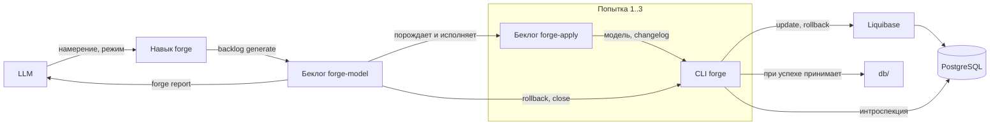
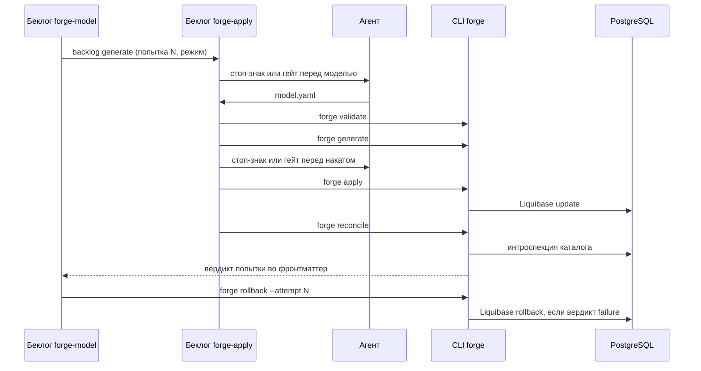

# Архитектура Liquibase Forge

Как работает система от намерения LLM до итогового отчёта: компоненты, поток операции,
последовательность одной попытки, контракт команд CLI `forge` и раскладка следа.
Понятия определены в [domain.md](./domain.md).

---

## Навигация

- [Принцип разделения](#принцип-разделения)
- [Компоненты](#компоненты)
- [Поток операции](#поток-операции)
- [Последовательность попытки](#последовательность-попытки)
- [Контракт команд CLI](#контракт-команд-cli)
- [Раскладка следа и принятого состояния](#раскладка-следа-и-принятого-состояния)
- [Ограничения и риски](#ограничения-и-риски)
- [Версионирование](#версионирование)

---

## Принцип разделения

- **Агент думает:** толкует намерение, пишет модель данных, правит её по расхождениям.
- **CLI исполняет:** проверка модели, построение changelog, накат, сверка, откат, закрытие,
  отчёт — детерминированно и проверяемо тестами.
- **Беклог задаёт порядок:** шаблоны `formular` фиксируют последовательность, стоп-знаки
  и лимит попыток. Ветвления по ходу исполнения в беклоге нет: задачи сформулированы как цели,
  а развилку по фронтматтеру решает команда CLI.

---

## Компоненты

| Компонент | Контекст | Роль |
|-----------|----------|------|
| Навык `forge` | Операция | Принимает намерение и режим, порождает беклог операции, передаёт его исполнителю беклога |
| Беклог `forge-model` | Операция | Журнал операции: три группы «попытка и откат», закрытие, отчёт |
| Беклог `forge-apply` | Операция | Одна попытка: модель, проверка, changelog, накат, сверка |
| Агент | Операция, Моделирование | Исполняет беклоги через `/backlog:backlog-run`, пишет модель данных |
| CLI `forge` | Моделирование, Миграция, Сверка, Операция | Детерминированные шаги и развилки |
| Liquibase | Миграция | Накат и откат changelog, журнал `DATABASECHANGELOG` |
| PostgreSQL | — | Тестовая целевая БД в Docker Compose (`lbfr-db`) |

---

## Поток операции



1. LLM вызывает навык `forge` с намерением и режимом.
1. Навык порождает беклог операции и передаёт его исполнителю `/backlog:backlog-run`.
1. Каждая группа попытки порождает беклог `forge-apply` и исполняет его до вердикта сверки.
1. Задача отката вызывает `forge rollback`: после успеха ничего не меняет, после неуспеха
   возвращает схему к состоянию до попытки.
1. Группы следующих попыток пропускаются, если модель уже подтверждена.
1. Закрытие под стоп-знаком или гейтом: `forge close` при успехе принимает модель и changelog
   в `db/`, после трёх неудач ставит `failure`.
1. `backlog verify` подтверждает полноту исполнения, `forge report` возвращает отчёт LLM.

---

## Последовательность попытки



Перед моделью стоп-знак попытки 1 показывает понимание намерения, попыток 2–3 — расхождения
предыдущей попытки и план правки. Перед накатом показываются changelog и адрес целевой БД.

---

## Контракт команд CLI

Каждая команда печатает в стандартный вывод ровно один JSON-объект; диагностика — только
в стандартный поток ошибок. Коды возврата: `0` — успех, `1` — неуспех операции, `2` — ошибка
вызова или окружения. Пути — относительные от корня проекта.

| Команда | Вход | Выход | `1` при |
|---------|------|-------|---------|
| `forge status` | беклог операции | статус операции, вердикты попыток, номер подтверждённой попытки | — |
| `forge validate` | файл модели | перечень нарушений модели с путями | модель некорректна |
| `forge generate` | модель попытки, принятая модель | путь changelog | модель требует неаддитивных изменений |
| `forge apply` | changelog, параметры БД из окружения | `apply.json`: результат Liquibase | ошибка Liquibase; адрес БД вне перечня тестовых |
| `forge reconcile` | модель, changelog | `reconcile.json`: перечень расхождений | есть расхождения |
| `forge rollback` | беклог операции, номер попытки | `rollback.json`: что откатано и проверка возврата | возврат схемы не подтверждён |
| `forge close` | беклог операции | статус операции; при `success` — пути в `db/` | — |
| `forge report` | беклог операции | итоговый отчёт для LLM | статус операции `failure` |

`forge rollback` после успешной сверки попытки ничего не меняет и возвращает `0`. Если Liquibase
rollback не удался, команда пересоздаёт тестовую БД и накатывает принятые changelog из `db/`.

---

## Раскладка следа и принятого состояния

```text
backlog/                         след, не коммитится
├── forge-model/<штамп>/
│   ├── tasks.md                 беклог операции и журнал
│   └── attempt-N/
│       ├── model.yaml
│       ├── changelog.yaml
│       ├── apply.json
│       ├── reconcile.json
│       └── rollback.json
└── forge-apply/<штамп>-<N>/
    └── tasks.md                 беклог попытки N
db/                              принятое состояние, коммитится
├── model.yaml
└── changelog/
```

---

## Ограничения и риски

- **Ограничение:** только PostgreSQL, только тестовая БД, только добавляющие изменения.
- **Ограничение:** команды CLI описаны контрактом; реализация — в следующих изменениях.
- **Допущение:** исходная БД пуста либо её схема полностью управляется Liquibase.
- **Риск:** вложенное исполнение беклога попытки из беклога операции `formular` отдельно
  не описывает → задача группы попытки называет путь беклога и предписывает загрузку
  исполнителя по `BKL-008`.
- **Риск:** до семи подтверждений на операцию в режиме `interactive` → режим `auto`.
- **Риск:** частично применённый changelog не откатывается Liquibase → пересоздание тестовой БД.

---

## Версионирование

| Версия | Дата | Задача | Агент | Модель | Описание изменений |
|--------|------|--------|-------|--------|--------------------|
| 1.0.0 | 2026-10-16 | OpenSpec change `design-foundation` | Claude Code | Claude Opus 5.5 | Начальное создание: принцип разделения агента, CLI и беклога, компоненты, поток операции, последовательность попытки, контракт команд CLI `forge`, раскладка следа и `db/`, ограничения и риски |
