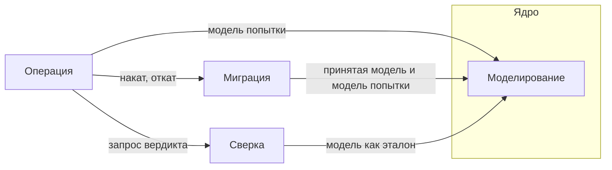

# Предметная область Liquibase Forge

Единственный источник понятий проекта: единый язык, ограниченные контексты и их связи, понятия
ядра модели данных. Остальные документы и шаблоны понятия используют, но не переопределяют.

---

## Навигация

- [Единый язык](#единый-язык)
- [Понятия formular](#понятия-formular)
- [Ограниченные контексты](#ограниченные-контексты)
- [Карта контекстов](#карта-контекстов)
- [Ядро модели данных](#ядро-модели-данных)
- [Ограничения и допущения](#ограничения-и-допущения)
- [Версионирование](#версионирование)

---

## Единый язык

### Операция и попытки

**Большая языковая модель (Large Language Model, LLM)** — пользователь Liquibase Forge: передаёт
намерение через навык `forge` и получает итоговый отчёт.

**Намерение (Intent)** — текст LLM, описывающий желаемое изменение модели данных. Записывается
во фронтматтер беклога операции до создания первой модели и далее не меняется.

**Режим операции (Operation Mode)** — `interactive` либо `auto`. В режиме `interactive` перед
контрольными задачами стоят стоп-знаки, в режиме `auto` — автоматические гейты. Режим задаётся
при начале операции, по умолчанию `interactive`, и до её конца не меняется.

**Автоматический гейт (Auto Gate)** — задача режима `auto` на месте стоп-знака: агент проверяет
машинно проверяемые условия и записывает решение с обоснованием во фронтматтер. Невыполненное
условие останавливает исполнение. Гейт стоп-знаком не является: подтверждения владельца он
не содержит.

**Попытка (Attempt)** — один проход от создания модели данных до вердикта сверки, исполняемый
отдельным беклогом попытки. Операция допускает не более трёх попыток; неуспешная откатывается
до начала следующей.

**Вердикт попытки (Attempt Verdict)** — `success` либо `failure` по результату сверки попытки.

**Статус операции (Operation Status)** — `running`, `stopped`, `success`, `failure` либо `abandoned`.
`stopped` — исполнение прекращено отказом владельца или непройденным гейтом, операцию можно
продолжить; `success` и `failure` — операция закрыта по итогу попыток; `abandoned` — операция
брошена владельцем: начатые попытки откатаны, ничего не принято. Закрытую операцию продолжить
нельзя.

**След операции (Operation Trail)** — беклог операции, беклоги попыток и файлы артефактов
каждой попытки. Фронтматтер беклога операции служит журналом операции: ссылается на всё
остальное.

**Итоговый отчёт (Operation Report)** — ответ LLM по завершении или остановке операции: статус,
число попыток, пути к модели и changelog, результаты сверки, перечень беклогов; при `failure` —
расхождения и результаты отката каждой попытки.

### Моделирование

**Модель данных (Data Model)** — описание целевого состояния схемы в собственном формате
Liquibase Forge, не привязанном к PostgreSQL. Описывает полное желаемое состояние, а не изменение.
Не путать с доменной моделью самого Liquibase Forge, которую описывает этот документ.

**Принятая модель (Accepted Model)** — модель данных последней успешно закрытой операции,
хранимая в корне принятого состояния. Точка отсчёта для changelog следующей операции.

**Корень принятого состояния (Accepted Root)** — каталог проекта, где лежат принятая модель
и принятые changelog операций. Задаётся переменной окружения `FORGE_ACCEPTED_DIR`, по умолчанию
`db/`: в целевом проекте он коммитится, в репозитории разработки Liquibase Forge вынесен
в игнорируемый git `.forge/db`.

### Миграция

**Changelog (Liquibase Changelog)** — миграция Liquibase для PostgreSQL, построенная как
разница между принятой моделью и моделью попытки: новые и удалённые таблицы и колонки.

**Накат (Apply)** — применение changelog к целевой БД средствами Liquibase.

**Откат (Rollback)** — возврат схемы целевой БД к состоянию до наката неуспешной попытки
с проверкой возврата.

### Сверка

**Сверка (Reconciliation)** — проверка соответствия фактической схемы модели данных и наличия
записи Liquibase о применённом changelog. Не путать с проверкой полноты беклога `backlog verify`.

**Фактическая схема (Actual Schema)** — структура целевой БД, полученная интроспекцией каталога
PostgreSQL, а не из changelog.

**Расхождение (Discrepancy)** — одно несоответствие, найденное сверкой: вид, объект, ожидаемое
и фактическое значение. Сверка успешна только при пустом перечне расхождений.

---

## Понятия formular

Понятия беклога принадлежат плагину `formular` и здесь не переопределяются (TERM-001). Текст
определений выдаёт вызов `backlog norms`: нормы и за ними глоссарий плагина.

| Понятие | Как используется в Liquibase Forge |
|---------|------------------------------------|
| Операция (Operation) | Liquibase Forge вводит две операции: `forge-model` — построение модели по намерению, `forge-apply` — одна попытка |
| Беклог операции (Operation Backlog) | Беклог операции — `forge-model`, беклог попытки — `forge-apply` |
| Шаблон операции (Operation Template) | `templates/forge-model.md`, `templates/forge-apply.md` |
| Фронтматтер беклога (Backlog Frontmatter) | Журнал операции и вердикты попыток |
| Стоп-знак (Stop Sign) | Перед созданием модели, перед накатом, перед закрытием операции — только в режиме `interactive` |
| Признак исполнения (Completion Marker) | Задачи формулируются как цели; признак проверяется командой CLI `forge` |

---

## Ограниченные контексты

| Контекст | Отвечает за | Ключевые понятия |
|----------|-------------|------------------|
| Операция | Порядок операции: намерение, попытки, откат, закрытие, отчёт | Намерение, режим операции, попытка, вердикт попытки, статус операции, след операции, итоговый отчёт, автоматический гейт |
| Моделирование | Собственный формат модели данных и проверка её корректности | Модель данных, принятая модель, понятия ядра |
| Миграция | Построение changelog, накат и откат | Changelog, накат, откат |
| Сверка | Сравнение фактической схемы с моделью и проверка записи Liquibase | Сверка, фактическая схема, расхождение |

Контексты связаны только через контракты (DDD-005). Агент работает в контексте Операции
и Моделирования: толкует намерение и пишет модель. Всё остальное — детерминированный CLI `forge`.

---

## Карта контекстов

Миграция и Сверка зависят от Моделирования, но не друг от друга: сверка читает фактическую схему
из БД, а не из changelog.

---

## Ядро модели данных

Понятия, которые формат модели данных обязан выразить; реализация понятий поэтапна. Синтаксис,
типы и правила проверки версии `1` формата описаны в [model-format.md](./model-format.md).

| Понятие | Смысл |
|---------|-------|
| Таблица (Table) | Именованный набор колонок |
| Колонка (Column) | Имя, тип и признак допустимости NULL |
| Тип (Type) | Тип колонки из перечня формата, а не тип СУБД |
| Первичный ключ (Primary Key, PK) | Непустой набор колонок таблицы, идентифицирующий строку |
| Внешний ключ (Foreign Key, FK) | Ссылка набора колонок на PK или набор уникальности другой либо той же таблицы |
| Обязательность (NOT NULL) | Запрет NULL в колонке |
| Уникальность (Unique) | Запрет повторяющихся значений набора колонок |

---

## Ограничения и допущения

- Поддерживаемая СУБД — PostgreSQL; независимость формата не означает поддержки других СУБД.
- Только локальная или тестовая БД; режим `auto` допустим только для неё.
- Изменения схемы — добавление и удаление таблиц, колонок, FK и наборов уникальности;
  изменение FK или набора выражается удалением и добавлением; смена типа, допустимости NULL
  и первичного ключа отклоняется.
- Код реализует ядро целиком: таблицы, колонки, типы, PK, NOT NULL, FK и уникальность.
  Действия FK при удалении и изменении (`ON DELETE`, `ON UPDATE`), `CHECK` и индексы в ядро
  не входят.

---

## Версионирование

| Версия | Дата | Задача | Агент | Модель | Описание изменений |
|--------|------|--------|-------|--------|--------------------|
| 1.0.0 | 2026-10-16 | OpenSpec change `design-foundation` | Claude Code | Claude Opus 5.5 | Начальное создание: единый язык контекстов Операция, Моделирование, Миграция и Сверка, понятия `formular` без переопределения, карта контекстов, ядро модели данных, ограничения |
| 1.0.1 | 2026-10-18 | OpenSpec change `forge-model-format` | Claude Code | Claude Opus 5.5 | В разделе «Ядро модели данных» открытое решение о синтаксисе формата заменено ссылкой на `model-format.md`; ограничение первого среза уточнено: таблиц в модели сколько угодно, связей между ними нет |
| 1.0.2 | 2026-10-21 | OpenSpec change `configurable-accepted-root` | Claude Code | Claude Opus 5.5 | В контекст «Моделирование» добавлено понятие «Корень принятого состояния (Accepted Root)»: каталог принятой модели и принятых changelog, задаётся `FORGE_ACCEPTED_DIR`, по умолчанию `db/`; определение принятой модели ссылается на корень вместо безусловного `db/` |
| 1.0.3 | 2026-10-22 | OpenSpec change `add-drop-operations` | Claude Code | Claude Opus 5.5 | Определение Changelog и ограничение изменений схемы приведены к поддержке удаления таблиц и колонок |
| 1.0.4 | 2026-10-22 | LBFR-015, OpenSpec change `add-model-relations` | Claude Code | Claude Opus 5.5 | Снято ограничение «связей нет»: код реализует FK и уникальность; определение FK расширено целью — набором уникальности и той же таблицей; в изменения схемы добавлены добавление и удаление FK и наборов уникальности, вне ядра названы `ON DELETE`/`ON UPDATE`, `CHECK` и индексы |
| 1.0.5 | 2026-10-23 | LBFR-022, OpenSpec change `add-operation-abandon` | Claude Code | Claude Opus 5.5 | Статус операции дополнен значением `abandoned`: операция брошена владельцем, начатые попытки откатаны, ничего не принято |
