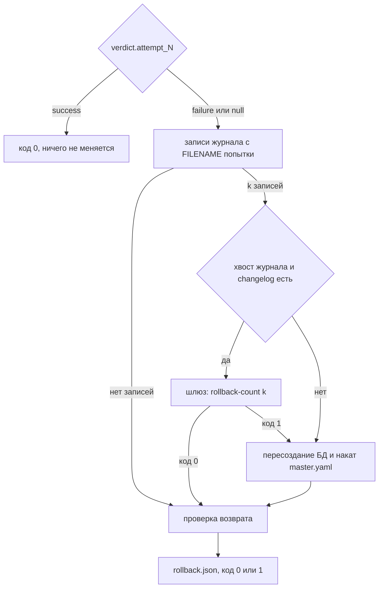

# Миграция: changelog, накат и откат

Как Liquibase Forge превращает модель данных в изменение схемы тестовой БД: построение changelog
командой `forge generate`, накат `forge apply` и откат `forge rollback`. Формат модели описан
в [model-format.md](./model-format.md), устройство системы — в [architecture.md](./architecture.md).

---

## Навигация

- [Changelog](#changelog)
- [Идентичность changeset](#идентичность-changeset)
- [Добавляющие изменения](#добавляющие-изменения)
- [Команда forge generate](#команда-forge-generate)
- [Накат](#накат)
- [Откат](#откат)
- [Проверка возврата](#проверка-возврата)
- [Запасной путь](#запасной-путь)
- [Ограничения и допущения](#ограничения-и-допущения)
- [Версионирование](#версионирование)

---

## Changelog

Changelog — добавляющая разница между принятой моделью `db/model.yaml` и моделью попытки.
Если принятой модели нет, она считается пустой, и changelog создаёт все таблицы модели.

Принятая модель:

```yaml
version: 1
tables:
  - name: customer
    columns:
      - {name: id, type: uuid}
    primary_key: [id]
```

Модель попытки:

```yaml
version: 1
tables:
  - name: customer
    columns:
      - {name: id, type: uuid}
      - {name: email, type: string, length: 255, nullable: false}
    primary_key: [id]
  - name: invoice_line
    columns:
      - {name: line_no, type: integer}
      - {name: invoice_id, type: bigint}
      - {name: amount, type: decimal, precision: 12, scale: 2}
    primary_key: [invoice_id, line_no]
```

Changelog операции со штампом `20261017-153000`:

```yaml
# Changelog операции 20261017-153000: построен forge generate, вручную не правится
databaseChangeLog:
- changeSet:
    id: 20261017-153000-01
    author: forge
    logicalFilePath: db/changelog/20261017-153000.yaml
    changes:
    - addColumn:
        tableName: customer
        columns:
        - column:
            name: email
            type: VARCHAR(255)
            constraints:
              nullable: false
- changeSet:
    id: 20261017-153000-02
    author: forge
    logicalFilePath: db/changelog/20261017-153000.yaml
    changes:
    - createTable:
        tableName: invoice_line
        columns:
        - column:
            name: line_no
            type: INTEGER
            constraints:
              nullable: false
        - column:
            name: invoice_id
            type: BIGINT
            constraints:
              nullable: false
        - column:
            name: amount
            type: NUMERIC(12, 2)
    - addPrimaryKey:
        tableName: invoice_line
        columnNames: invoice_id, line_no
        constraintName: pk_invoice_line
```

Тест проверяет, что `forge generate` строит из этих моделей ровно этот changelog.

Правила построения:

- **Порядок.** Changeset идут в порядке таблиц модели попытки, внутри таблицы — в порядке колонок.
- **Таблица.** Новая таблица — один changeset из `createTable` и `addPrimaryKey`. Первичный ключ
  (Primary Key, PK) создаётся отдельно, чтобы сохранить порядок колонок `primary_key` модели;
  признак `primaryKey` в колонках построил бы ключ в порядке колонок таблицы.
- **Колонка.** Новая колонка существующей таблицы — один changeset `addColumn`.
- **NOT NULL.** `nullable: false` получают колонки PK и колонки с `nullable: false`.
- **Типы.** Отображение типов в PostgreSQL — по таблице [model-format.md](./model-format.md#типы-колонок).
  `timestamp` пишется как `TIMESTAMP WITHOUT TIME ZONE`, `timestamp_tz` — как
  `TIMESTAMP WITH TIME ZONE`.
- **Совпадающие модели.** Changelog без changeset: `databaseChangeLog: []`.
- **Повторяемость.** Повторная генерация с теми же аргументами даёт побайтово тот же файл.

Откат changeset Liquibase выводит сам: `dropPrimaryKey` и `dropTable` для таблицы, `dropColumn`
для колонки.

---

## Идентичность changeset

| Атрибут | Значение | Зачем |
|---------|----------|-------|
| `id` | `<штамп>-<NN>`, номер от `01`, минимум две цифры | Однозначен в пределах операции |
| `author` | `forge` | Отличает changeset Liquibase Forge |
| `logicalFilePath` | `db/changelog/<штамп>.yaml` у каждого changeset | Запись `DATABASECHANGELOG` одинакова, накатан ли файл из следа попытки или из `db/` |

Штамп — `subject` беклога операции в виде `YYYYMMDD-HHMMSS`. Все попытки одной операции получают
одинаковые `id`. Конфликта в журнале нет: неуспешная попытка откатывается до начала следующей.

---

## Добавляющие изменения

Changelog первой поставки выражает только новые таблицы и новые колонки существующих таблиц.
Всё остальное — неаддитивное изменение: `forge generate` отклоняет модель кодом `1` и перечисляет
все такие изменения сразу.

| Код | Когда |
|-----|-------|
| `table_removed` | Таблица есть в принятой модели и отсутствует в модели попытки |
| `column_removed` | Колонка есть в принятой модели и отсутствует в модели попытки |
| `column_type_changed` | У колонки другой тип или другие параметры типа |
| `column_nullable_changed` | У колонки другая итоговая допустимость NULL |
| `primary_key_changed` | У таблицы другой набор или порядок колонок PK |

Уточнения:

- **Переименование** неотличимо от удаления с добавлением и отклоняется как удаление.
- **Итоговая допустимость NULL** учитывает PK: явное `nullable: false` у колонки PK изменением
  не считается.
- **Порядок колонок таблицы** изменением не считается.
- **Новая колонка с `nullable: false`** в существующей таблице разрешена. На непустой таблице
  накат завершится ошибкой Liquibase, и попытка станет неуспешной с понятной диагностикой.

---

## Команда forge generate

```bash
forge generate --model <модель попытки> --accepted db/model.yaml \
  --operation <беклог операции> --out <каталог попытки>/changelog.yaml
```

| Код | Когда | Ответ |
|-----|-------|-------|
| `0` | Changelog записан | `changelog`, `logical_file_path`, перечень `changesets` с `id`, видом (`create_table`, `add_column`), таблицей и колонкой |
| `1` | Модель попытки нарушает формат или требует неаддитивных изменений | `changelog: null`, `violations` как у `forge validate` либо `non_additive`; прежний файл `--out` удалён |
| `2` | Нет беклога операции или `subject` не штамп; модель попытки не прочитать; принятая модель есть, но некорректна | Объект `error` с видом `operation_unavailable`, `model_unreadable` или `accepted_model_invalid` |

При отказе прежний changelog удаляется, чтобы устаревший файл нельзя было накатить.

---

## Накат

```bash
forge apply --changelog <каталог попытки>/changelog.yaml
```

Агент работает без Docker и Liquibase, поэтому накат идёт через шлюз на хосте:

1. Команда берёт адрес целевой БД из `FORGE_DB_HOST`, `FORGE_DB_PORT`, `FORGE_DB_NAME`
   и проверяет его по `FORGE_TEST_DB_ALLOWLIST`. БД вне перечня отклоняется до обращения
   к раннеру.
1. Команда пишет запрос `.forge/liquibase-request.json` и вызывает цель раннера
   `liquibase-update`. Шлюз повторно проверяет перечень и запускает Liquibase в контейнере
   `lbfr-liquibase`.
1. Команда читает `.forge/liquibase-result.json` и принимает его, только если идентификатор
   запроса совпадает.

| Код | Когда | `apply.json` |
|-----|-------|--------------|
| `0` | Liquibase выполнил накат | Записан |
| `1` | Liquibase завершился ошибкой; диагностика продублирована в stderr | Записан |
| `2` | Переменные окружения не заданы, БД вне перечня, раннер недоступен, шлюз отказал, результат не прочитан или относится к другому запросу | Не записан |

`apply.json` лежит рядом с changelog. В нём путь changelog, адрес БД, `request_id`, код исхода,
вывод и диагностика Liquibase. При коде `2` файла нет намеренно: беклог попытки по его наличию
считает накат выполненным.

Код `1` — штатный путь: за ним идёт сверка с вердиктом `failure` и откат. Из нескольких changeset
могли примениться не все; откат снимает ровно применённые.

Вид ошибки в ответе с кодом `2`: `settings_unavailable`, `database_not_allowed`,
`runner_unavailable`, `gateway_refused`, `gateway_result_invalid`.

---

## Откат

```bash
forge rollback --operation <беклог операции> --attempt <N>
```

Команда не оставляет в тестовой БД неподтверждённых изменений попытки `N`. Решение принимается
по вердикту попытки во фронтматтере беклога операции и по журналу `DATABASECHANGELOG`.



- **Записи попытки.** Это строки журнала с `FILENAME` = `db/changelog/<штамп>.yaml`. Предыдущие
  попытки операции к этому моменту откатаны, у принятых changelog другие штампы.
- **Частичный накат.** Откатывается столько changeset, сколько их фактически записано в журнал,
  а не сколько их в changelog.
- **Хвост журнала.** Последние `k` записей по порядку исполнения — ровно записи попытки, и их `id`
  есть в changelog попытки. Иначе Liquibase rollback не вызывается.
- **Вердикт `success`.** Команда только печатает ответ с `action: none` и не пишет `rollback.json`.

| Код | Когда |
|-----|-------|
| `0` | Возврат подтверждён, откатывать было нечего, или вердикт `success` |
| `1` | Возврат не подтверждён: проверка или накат принятого состояния не прошли |
| `2` | Нет беклога операции, переменные окружения не заданы, БД вне перечня, БД или раннер недоступны, шлюз отказал |

`rollback.json` пишется в каталог попытки. В нём номер попытки и вердикт, действие (`none_applied`,
`liquibase_rollback` или `recreate_database`), число откатанных changeset, результат шлюза,
причина и итог запасного пути, перечень проверок и итог `verified`.

---

## Проверка возврата

После отката команда проверяет:

| Проверка | Что подтверждает |
|----------|------------------|
| `journal_clean` | В журнале нет записей changelog попытки |
| `table_absent` | Нет таблицы, которую создаёт changelog попытки |
| `column_absent` | Нет колонки, которую добавляет changelog попытки |
| `accepted_restored` | Только на запасном пути: принятый `master.yaml` накатан или его нет |
| `attempt_objects` | Только без changelog попытки: объекты попытки не проверить, проверен один журнал |

Проверка смотрит только объекты попытки, а не всю схему. Полное сравнение схемы с моделью —
сверка `forge reconcile`.

---

## Запасной путь

Запасной путь выбирается, если откат Liquibase завершился ошибкой, записи попытки не являются
хвостом журнала или changelog попытки отсутствует:

1. Перечень тестовых проверяется повторно, вплотную к удалению БД.
1. Под служебной БД `postgres` того же сервера выполняются `DROP DATABASE … WITH (FORCE)`
   и `CREATE DATABASE` с учётными данными `FORGE_DB_USER` и `FORGE_DB_PASSWORD`.
1. Если есть `db/changelog/master.yaml`, он накатывается через шлюз. Если нет, принятого
   состояния нет, и БД остаётся пустой.

> **Внимание:** запасной путь удаляет целевую БД. Он выполняется только для БД из
> `FORGE_TEST_DB_ALLOWLIST`, а пользователю `FORGE_DB_USER` нужно право создавать БД.

---

## Ограничения и допущения

- **Ограничение:** только PostgreSQL и только добавляющие изменения.
- **Допущение:** схема целевой БД полностью управляется Liquibase, а принятая модель описывает её
  состояние.
- **Ограничение:** корень проекта — текущий каталог: команды вызываются из корня, иначе шлюз
  не найдёт changelog, а команда — файл результата.
- **Ограничение:** файлы `.forge/` общие, раннер однопоточный, поэтому команды `forge apply`
  и `forge rollback` не запускаются параллельно.
- **Риск:** Liquibase может перевести имя типа иначе, чем ожидается → интеграционный тест
  сравнивает фактические типы колонок с таблицей отображения.

---

## Версионирование

| Версия | Дата | Задача | Агент | Модель | Описание изменений |
|--------|------|--------|-------|--------|--------------------|
| 1.0.0 | 2026-10-18 | OpenSpec change `forge-migration` | Claude Code | Claude Opus 5.5 | Начальное создание: правила построения changelog с примером, идентичность changeset, состав добавляющих изменений и коды неаддитивных, команда `forge generate`, накат и `apply.json`, откат со схемой решений, проверка возврата, запасной путь с пересозданием БД |
