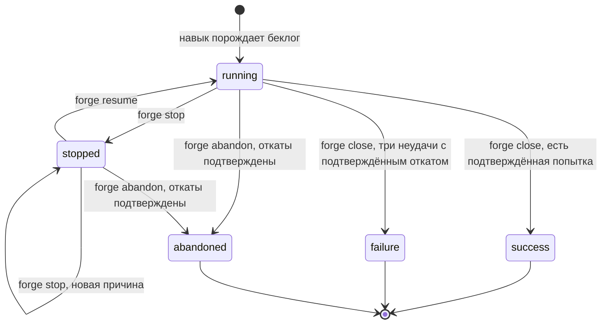

# Операция

Как Liquibase Forge ведёт операцию от намерения LLM до итогового отчёта: навык `forge`,
статусы операции, команды `forge status`, `stop`, `resume`, `close`, `abandon`, `report`, принятие модели
в корень принятого состояния и шаблоны беклогов. Понятия определены в [domain.md](./domain.md), поток операции —
в [architecture.md](./architecture.md).

---

## Навигация

- [Навык forge](#навык-forge)
- [Согласие на удаления](#согласие-на-удаления)
- [Статусы операции](#статусы-операции)
- [Команды](#команды)
- [Поиск открытой операции](#поиск-открытой-операции)
- [Принятое состояние](#принятое-состояние)
- [Итоговый отчёт](#итоговый-отчёт)
- [Шаблоны беклогов](#шаблоны-беклогов)
- [Ограничения и допущения](#ограничения-и-допущения)
- [Версионирование](#версионирование)

---

## Навык forge

Большая языковая модель (Large Language Model, LLM) вызывает Liquibase Forge одним навыком:

```text
/forge <намерение> [--mode interactive|auto] [--allow-drop]
/forge --abandon "<причина>"
```

1. Навык проверяет, что доступен CLI плагина `formular` `backlog`.
1. `forge status --latest` проверяет среду и ищет открытую операцию.
1. Открытая операция продолжается, при статусе `stopped` — после `forge resume`. Новое намерение
   при этом не принимается, и LLM получает об этом сообщение. Ключ `--allow-drop` даёт согласие
   остановленной операции в `auto` через `forge resume --allow-drop`; см.
   [Согласие на удаления](#согласие-на-удаления).
1. Иначе порождается беклог `backlog/forge-model/<штамп>/tasks.md`, штамп — UTC
   `YYYYMMDD-HHMMSS`, признак `allow_drop` — по ключу `--allow-drop`.
1. Беклог исполняется носителем порядка `/backlog:backlog-run`.
1. LLM получает вывод `forge report`.

С ключом `--abandon` навык не исполняет беклог, а бросает единственную открытую операцию:
`forge abandon`, затем `forge report` — см. [Отказ от операции](#отказ-от-операции). Ключ
принимается только отдельно, без намерения, `--mode` и `--allow-drop`.

Инструкция навыка — [.claude/skills/forge/SKILL.md](../.claude/skills/forge/SKILL.md). Команды
`forge` из беклогов выполняются из корня проекта обёрткой `sh tools/forge-env/forge.sh …`: она
запускает CLI и в репозитории forge, и в проекте, куда forge поставлен установщиком.

---

## Согласие на удаления

Удаление таблиц и колонок — штатное изменение схемы. Допустимость удаления в режиме `auto` решает
CLI по признаку `allow_drop` беклога операции, а не агент.

| Режим | `allow_drop` | Удаления |
|-------|--------------|----------|
| `auto` | `true` — ключ `--allow-drop` | Строятся; гейт перед накатом записывает решение с обоснованием |
| `auto` | `false` — ключа нет или беклог прежнего шаблона | `forge generate` отвечает кодом `2` с видом `drop_not_allowed` и перечнем объектов, changelog не записан; операция останавливается, попытка не расходуется. Продолжить с согласием — `/forge --mode auto --allow-drop` |
| `interactive` | `false`, ключ не принимается | Строятся; стоп-знак перед накатом показывает их отдельным перечнем с предупреждением о потере данных |

- **Фронтматтер.** `allow_drop: true|false` пишется в беклог операции и в беклоги попыток. Беклог
  без поля читается как `allow_drop: false`.
- **Согласие при продолжении.** Остановленной операции в `auto` согласие даёт
  `forge resume --operation <беклог> --allow-drop`: команда пишет `allow_drop: true` в беклог
  операции и в беклоги попыток из `backlog.attempt_N` — строка заменяется или, в беклоге прежнего
  шаблона, вставляется после `mode`. Следующие попытки порождаются по значению фронтматтера беклога
  операции. Снять согласие нельзя; операции `running` и операции `interactive` ключ не меняет.
- **Статус и отчёт.** `forge status` и `forge report` называют `allow_drop` рядом с режимом. Отчёт
  перечисляет в `destructive` удаления итогового changelog — принятого при `success`, иначе
  последней начатой попытки; у удалённой таблицы `column: null`. Нет итогового changelog или
  удалений в нём — перечень пуст. Удаление набора уникальности или внешнего ключа данных
  не удаляет: в перечень оно не входит и согласия `allow_drop` не требует.

> **Внимание:** откат возвращает только структуру удалённых таблиц и колонок, данные не
> восстанавливаются. Принятый changelog с удалением при переносе на рабочую БД удалит данные —
> перечень `destructive` делает это видимым при ревью коммита.

---

## Статусы операции



- **Кто меняет статус.** Только CLI. Шаблоны предписывают `forge stop` при отказе владельца,
  непройденном гейте и коде `2` любой команды `forge`. Причина записывается
  во фронтматтер в `stop_reason`.
- **Закрытые статусы.** `success`, `failure` и `abandoned`: `forge stop` и `forge resume` их не меняют,
  `forge status --latest` такую операцию не находит.
- **`stop_reason` — причина прекращения исполнения.** У остановленной операции это причина
  остановки, у брошенной — причина отказа: она заменяет прежнюю причину остановки. Читается
  вместе со статусом.
- **Остановка не тратит попытку.** Повторный вызов навыка продолжает беклог с задачи, признак
  которой не выполнен.
- **Запись во фронтматтер.** Команды меняют только строки `status` и `stop_reason`, остальной
  текст беклога остаётся побайтово прежним. В беклоге по шаблону 1.0.0 строки `stop_reason`
  нет — она вставляется после `status` при первой остановке.

---

## Команды

| Команда | Что делает | `0` | `1` | `2` |
|---------|-----------|-----|-----|-----|
| `forge status --operation <беклог>` | Намерение, режим, `allow_drop`, статус, попытки, подтверждённая попытка и проверка среды | Среда в порядке | — | Проверка среды не пройдена; беклог не прочитать |
| `forge status --latest` | То же для единственной открытой операции следа либо `operation: null` | Среда в порядке | — | Проверка среды не пройдена; открытых операций больше одной |
| `forge stop --operation <беклог> --reason <текст>` | `running` или `stopped` → `stopped` с причиной | Остановлена | Операция закрыта | Беклог не прочитать |
| `forge resume --operation <беклог> [--allow-drop]` | `stopped` → `running`, причина сбрасывается; с ключом — согласие на удаления в `auto` | Продолжена | Операция не остановлена или закрыта; ключ для операции `interactive` | Беклог операции или попытки не прочитать |
| `forge close --operation <беклог>` | Закрытие с исходом `success` или `failure` | Закрыта или уже была закрыта | Закрывать рано | Беклог не прочитать; корень принятого состояния некорректен либо принять в него не удалось |
| `forge abandon --operation <беклог> --reason <текст>` | Откат начатых попыток и `running` или `stopped` → `abandoned` с причиной | Брошена или уже была брошена | Операция закрыта с `success` или `failure`; откат не подтверждён | Беклог не прочитать; окружение не задано; БД вне перечня; раннер недоступен; шлюз отказал |
| `forge report --operation <беклог>` | Итоговый отчёт | Отчёт собран | Статус `failure` | Беклог не прочитать |

Проверка среды `forge status`:

| Проверка | Пройдена, если |
|----------|----------------|
| `database` | Подключение по `FORGE_DB_*` выполняет `SELECT 1` |
| `allowlist` | Целевая БД входит в непустой `FORGE_TEST_DB_ALLOWLIST` |
| `runner` | `AGENT_RUNNER_*` заданы, и цель `help` раннера отвечает |
| `accepted` | `FORGE_ACCEPTED_DIR` пуст либо задаёт относительный путь внутри корня проекта; итог называет корень принятого состояния. Существование каталога не проверяется |

Проверки независимы: ответ называет итог каждой, даже если первая не прошла.

Исход `forge close`:

- **Есть попытка с вердиктом `success`** — модель и changelog принимаются в корень принятого состояния, статус
  `success`. Файлы принимаются до записи статуса: сбой принятия оставляет операцию открытой.
- **Все три попытки `failure`, у каждой `rollback.json` с `verified: true`** — статус `failure`,
  корень принятого состояния не меняется.
- **Иначе** — код `1` с причиной, ничего не меняется. Так же отвечает закрытие остановленной
  операции: сначала `forge resume`.

### Отказ от операции

`forge abandon` закрывает открытую операцию по решению владельца, ничего не принимая. Корень
принятого состояния команда не меняет ни при каком исходе.

1. Начатые попытки — с порождённым беклогом — обходятся по убыванию номера: накатанной может
   быть только последняя начатая.
1. Попытка, у которой уже есть `rollback.json` с `verified: true`, не откатывается повторно.
1. Остальные откатываются тем же порядком, что `forge rollback`, в том числе попытка с вердиктом
   `success` — см. [migration.md](./migration.md#откат). Первый неподтверждённый откат прекращает
   обход.
1. Если откат каждой начатой попытки подтверждён — статус `abandoned`, причина в `stop_reason`.

Исход:

- **Все откаты подтверждены** — код `0`; ответ называет операцию, откаты попыток (путь
  `rollback.json`, `verified`, выполнен ли откат в этом вызове) и `changed`.
- **Откат не подтверждён** — код `1` с причиной `refused` и откатами этого вызова, статус прежний.
  Записанные `rollback.json` остаются, повторный отказ их учтёт.
- **Операция `success` или `failure`** — код `1`, ничего не меняется. Повторный отказ от брошенной
  операции — код `0` с `changed: false`.
- **Ошибка окружения** — код `2` с видом ошибки, как у `forge rollback`; статус прежний.

Беклог брошенной операции не обязан проходить `backlog verify`: исполнение прервано, и задачи
наката и закрытия остаются неотмеченными.

---

## Поиск открытой операции

Корень следа — `BACKLOG_ROOT` либо каталог `backlog` в текущем каталоге, как у плагина
`formular`. `forge status --latest` читает фронтматтеры `<корень>/forge-model/*/tasks.md`.

| Найдено | Ответ |
|---------|-------|
| Ни одной операции `running` или `stopped` | `operation: null` |
| Одна | Её статус и попытки |
| Больше одной | Код `2`, вид ошибки `several_open_operations` и перечень путей |

Нечитаемый беклог пропускается с предупреждением в stderr: чужой след не блокирует новую
операцию.

---

## Принятое состояние

Корень принятого состояния задаёт `FORGE_ACCEPTED_DIR` — относительный путь внутри корня проекта.
Незаданная или пустая переменная даёт `db`: в целевом проекте принятое состояние лежит в `db/`
и коммитится. В репозитории разработки Liquibase Forge переменная равна `.forge/db`, чтобы
проверочные прогоны не попадали в git. Абсолютный путь и выход за корень проекта — код `2`.

При `success` команда `forge close` записывает в корень принятого состояния `<корень>`:

| Файл | Откуда |
|------|--------|
| `<корень>/model.yaml` | `model.yaml` подтверждённой попытки — новая принятая модель |
| `<корень>/changelog/<штамп>.yaml` | `changelog.yaml` подтверждённой попытки, побайтово |
| `<корень>/changelog/master.yaml` | В конец дописывается `include: {file: <штамп>.yaml, relativeToChangelogFile: true}`, если его ещё нет |

`logicalFilePath` changeset всегда `db/changelog/<штамп>.yaml` и от `<корень>` не зависит: журнал
`databasechangelog` одинаков в разработке и в целевом проекте. Физическое расположение файла
на накат не влияет — `include` задан относительно `master.yaml`.

Повторное закрытие ничего не меняет. Принятый `master.yaml` накатывается Liquibase на пустую
БД в порядке принятия операций: это проверяет интеграционный тест, на это же опирается запасной
путь отката (см. [migration.md](./migration.md#запасной-путь)).

> **Важно:** `forge close` не коммитит. Принятое состояние коммитит владелец, указав код
> и номер задачи в сообщении коммита.

---

## Итоговый отчёт

`forge report --operation <беклог>` ничего не меняет и собирает ответ для LLM:

- **Операция:** путь беклога, штамп, намерение, режим, `allow_drop`, статус, причина остановки
  или отказа (`stop_reason`).
- **Удаления:** перечень `destructive` итогового changelog — см. [Согласие на удаления](#согласие-на-удаления).
- **Число использованных попыток** — попыток с записанным вердиктом.
- **Итоговые модель и changelog:** при `success` — файлы корня принятого состояния, иначе — файлы последней
  начатой попытки.
- **Каждая начатая попытка:**
  - вердикт, беклог и каталог;
  - пути `model.yaml` и `changelog.yaml`;
  - вердикт и расхождения из `reconcile.json`;
  - действие, число откатанных changeset и `verified` из `rollback.json`.
- **Перечень беклогов:** беклог операции и беклоги попыток.
- **Файлы для коммита и напоминание о коммите** — у закрытой операции, поле `commit`.

Код `1` — только при статусе `failure`. Отчёт о брошенной, остановленной или ещё открытой
операции возвращает `0`.

### Файлы для коммита

В целевом проекте вместе с принятым состоянием коммитится след операции: он объясняет, как
получена принятая модель, а после неудачи или отказа — почему схема не изменилась. Каталог коммитится
целиком, с артефактами попыток.

| Статус | `commit.files` |
|--------|----------------|
| `success` | `<корень>/model.yaml`, `<корень>/changelog/<штамп>.yaml`, `<корень>/changelog/master.yaml`, каталог операции `backlog/forge-model/<штамп>/`, каталоги беклогов попыток `backlog/forge-apply/<штамп>-<N>/` |
| `failure` | Каталог операции и каталоги беклогов попыток; файлов корня принятого состояния нет |
| `abandoned` | Каталог операции и каталоги беклогов начатых попыток; файлов корня принятого состояния нет |
| `running`, `stopped` | `commit: null` — операция не закрыта, коммитить рано |

Пароль БД в след не попадает: шлюз передаёт учётные данные Liquibase через окружение, а не
командной строкой. Имя пользователя может встретиться в выводе Liquibase при ошибке
подключения, который сохраняется в `apply.json` и `rollback.json`.

В репозитории разработки Liquibase Forge след исключён строкой `backlog/*` в `.gitignore`.

---

## Шаблоны беклогов

Шаблоны `templates/forge-model.md` версии 1.2.1 и `templates/forge-apply.md` версии 1.3.0
принимаются `backlog check-template` по всем сочетаниям признаков (BKL-009).

| Шаблон | Изменения версии 1.1.0 |
|--------|------------------------|
| `forge-model.md` | Блок `trail` с каталогами попыток; поле `stop_reason`; отказ, непройденный гейт и код `2` ведут к `forge stop` |
| `forge-apply.md` | `forge generate` получает `--operation {{parent}}`; та же фраза об остановке с `--operation {{parent}}`; задача 2.1 без вложенных условных блоков |

| Шаблон | Изменения версии 1.2.0 |
|--------|------------------------|
| `forge-apply.md` | Задача 2.4 вызывает `forge generate` без `--accepted`: принятую модель CLI берёт из корня принятого состояния, и литерал `db/model.yaml` в беклог не попадает. Беклоги версии 1.1.0 с `--accepted db/model.yaml` остаются исполнимыми |

| Шаблон | Изменения версии 1.2.0 |
|--------|------------------------|
| `forge-model.md` | Признак `allow-drop`: поле `allow_drop` во фронтматтере; задачи порождения попыток передают `--flag allow-drop` либо `--no-flag allow-drop` по значению `allow_drop` во фронтматтере, а не по флагу, вшитому при порождении |

| Шаблон | Изменения версии 1.2.1 |
|--------|------------------------|
| `forge-model.md` | Правило остановки называет выход для владельца, который передумал: `/forge --abandon "<причина>"`; сам беклог операцию не бросает |

| Шаблон | Изменения версии 1.3.0 |
|--------|------------------------|
| `forge-apply.md` | Поле `allow_drop`; стоп-знак 3.1 перечисляет удаления с предупреждением о потере данных; условие гейта 3.1 без «только добавляющие изменения»; отказ `drop_not_allowed` в задаче 2.4 прекращает исполнение |

> **Внимание:** условные блоки в шаблонах не вкладываются друг в друга. Плагин `formular` 1.3.0
> оставляет в беклоге текст выключенного блока, если внутри него есть другой блок, а
> `backlog check-template` этого не замечает. Поэтому блоки режима, номера попытки и согласия
> на удаления идут подряд, а тест `tests/operation/test_templates.py` порождает все восемь
> вариантов и проверяет, что текст чужой ветки в беклог не попал.

Каталог попытки берётся из `trail.attempt_N`, а в беклогах по шаблону 1.0.0 выводится
по раскладке следа. Имена файлов в каталоге фиксированы: `model.yaml`, `changelog.yaml`,
`apply.json`, `reconcile.json`, `rollback.json`.

---

## Ограничения и допущения

- **Ограничение:** одна открытая операция; параллельные операции не поддерживаются.
- **Ограничение:** удаления в `auto` возможны только при `allow_drop: true`: признак задаётся
  при начале операции или даётся при продолжении остановленной операции и не снимается.
- **Ограничение:** закрытую операцию нельзя отменить, принятое состояние не откатывается.
  `forge abandon` бросает только открытую операцию.
- **Ограничение:** бросать операцию, беклог которой сейчас исполняет агент в другой сессии, нельзя:
  одна операция — одна сессия. Отказ вызывается после остановки или стоп-знака.
- **Ограничение:** корень следа forge — `backlog/` в корне проекта. Переменная `BACKLOG_ROOT`
  плагина `formular` для операций forge не поддерживается: шаблоны `forge-model` и `forge-apply`
  называют пути следа литералами `backlog/…`, и перенесённый след ссылался бы на несуществующие
  беклоги.
- **Допущение:** плагин `backlog@formular` установлен в проект. Его `backlog` появляется в `PATH`
  сессии, начатой после установки; навык находит его и в каталоге плагина.
- **Риск:** агент правит фронтматтер вне предписанных полей → статус меняют только команды,
  а неизвестный статус или вердикт `forge status` отклоняет кодом `2`.

---

## Версионирование

| Версия | Дата | Задача | Агент | Модель | Описание изменений |
|--------|------|--------|-------|--------|--------------------|
| 1.0.0 | 2026-10-18 | OpenSpec change `forge-operation` | Claude Code | Claude Opus 5.5 | Начальное создание: навык `forge`, статусы и переходы, команды `status`, `stop`, `resume`, `close`, `report` с кодами, проверка среды, поиск открытой операции, принятие в `db/`, отчёт, шаблоны 1.1.0 |
| 1.0.1 | 2026-10-21 | OpenSpec change `configurable-accepted-root` | Claude Code | Claude Opus 5.5 | В таблицу проверок среды `forge status` добавлена четвёртая проверка `accepted`: корректность `FORGE_ACCEPTED_DIR` и итоговый корень принятого состояния. Принятие переведено с безусловного `db/` на корень принятого состояния: раздел «Принятое состояние» описывает `FORGE_ACCEPTED_DIR`, умолчание `db`, значение `.forge/db` для репозитория разработки и независимость `logicalFilePath` от корня; таблица команд, исход `forge close` и итоговый отчёт называют корень вместо `db/`; убрано утверждение о равенстве `logicalFilePath` физическому пути. Раздел «Шаблоны беклогов» дополнен изменениями `forge-apply.md` версии 1.2.0 |
| 1.0.2 | 2026-10-21 | OpenSpec change `commit-operation-trail` | Claude Code | Claude Opus 5.5 | В раздел «Итоговый отчёт» добавлен подраздел «Файлы для коммита»: в целевом проекте коммитится след закрытой операции вместе с принятым состоянием, состав `commit.files` для `success`, `failure` и открытой операции, оговорка о данных подключения в выводе Liquibase; в ограничения добавлено: `BACKLOG_ROOT` для операций forge не поддерживается |
| 1.0.3 | 2026-10-22 | OpenSpec change `add-drop-operations` | Claude Code | Claude Opus 5.5 | Раздел «Согласие на удаления»: `allow_drop` в режимах `auto` и `interactive`, отказ `drop_not_allowed`, перечень `destructive`; ключ `--allow-drop` навыка; `allow_drop` в `forge status` и `forge report`; шаблоны `forge-model` 1.2.0 и `forge-apply` 1.3.0 |
| 1.0.4 | 2026-10-22 | OpenSpec change `add-drop-operations` | Claude Code | Claude Opus 5.5 | Согласие на удаления при продолжении: `forge resume --allow-drop` вместо неизменности признака, подсказка продолжения в отказе `drop_not_allowed`, строка `forge resume` в таблице команд, порождение попыток `forge-model` 1.2.0 по значению фронтматтера, ограничение |
| 1.0.5 | 2026-10-22 | LBFR-015, OpenSpec change `add-model-relations` | Claude Code | Claude Opus 5.5 | Раздел «Согласие на удаления»: удаление набора уникальности или внешнего ключа не входит в перечень `destructive` и не требует `allow_drop` |
| 1.0.6 | 2026-10-22 | LBFR-016, OpenSpec change `add-forge-installer` | Claude Code | Claude Opus 5.5 | Команды `forge` из беклогов выполняются обёрткой `sh tools/forge-env/forge.sh …` вместо прямого запуска через `uv run`: в установленном проекте CLI лежит в uv-подпроекте `tools/forge/` |
| 1.0.7 | 2026-10-23 | LBFR-022, OpenSpec change `add-operation-abandon` | Claude Code | Claude Opus 5.5 | Отказ от открытой операции: ключ навыка `--abandon`, статус `abandoned` на диаграмме и среди закрытых, `stop_reason` как причина прекращения исполнения, строка `forge abandon` в таблице команд, подраздел «Отказ от операции» — порядок откатов и исход, отчёт и `commit.files` для `abandoned`, шаблон `forge-model` 1.2.1, ограничения об отказе только от открытой операции и об одной сессии |
