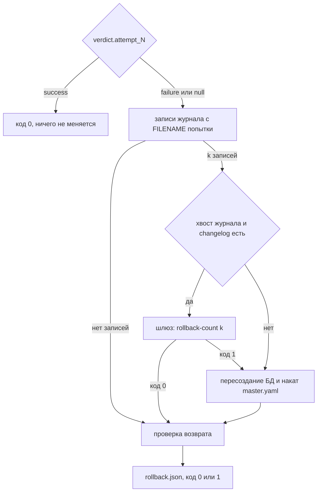

# Design

## Context

Мотивация — в proposal.md, требования — в `specs/forge-migration/spec.md`.

Исходное состояние:

- **Моделирование готово (change 1).** Агрегат `DataModel`, фабрика, разборщик YAML
  и `forge validate` уже есть.
- **CLI.** Команды регистрируются модулями `src/forge/cli/commands/`.
- **Шлюз Liquibase (change 0).** Он принимает `.forge/liquibase-request.json`, вызывается
  целями `liquibase-update` и `liquibase-rollback` через раннер и пишет
  `.forge/liquibase-result.json` с кодом `0`, `1` или `2`.
  - Changelog должен лежать внутри проекта, путь — относительно корня.
  - Учётные данные БД шлюз выбирает по хосту запроса.
- **Окружение агента.** Docker и Liquibase агенту недоступны, PostgreSQL доступен напрямую
  по сети Compose (Q24).
- **Беклог операции.** Его фронтматтер содержит `subject` (штамп операции) и
  `verdict.attempt_N`. Каталог попытки — `<каталог беклога операции>/attempt-N/` по раскладке
  `architecture.md`. Блок `trail` (Q35) появится только в change 4.
- **`db/` ещё нет.** Принятая модель и `master.yaml` появятся в change 4 вместе с `forge close`.

## Goals / Non-Goals

**Goals:**

- Changelog, который детерминированно выводится из двух моделей и даёт ровно ту схему, которую
  потом проверит сверка change 3.
- Накат и откат, у которых ошибка Liquibase отделена от ошибки окружения кодом возврата.
- Откат, который при любом сбое Liquibase всё равно возвращает тестовую БД к принятому состоянию.

**Non-Goals:**

- Полная сверка схемы с моделью: проверка возврата смотрит только объекты попытки и журнал.
  Полное сравнение — `forge reconcile` в change 3.
- Чтение и запись блока `trail`, статусов и прочих полей фронтматтера, кроме `subject`
  и `verdict.attempt_N`, — change 4.
- Накат на БД вне перечня тестовых и любая работа с production.

## Decisions

### Состав модулей

| Слой | Компонент | Роль |
|------|-----------|------|
| Моделирование, приложение | `LoadModelUseCase` | Модель из файла через разборщик и фабрику; признак «нет файла — пустая модель»; нарушения формата — `InvalidModelError` с нарушениями |
| Миграция, домен | `OperationStamp` | Объект-значение штампа `YYYYMMDD-HHMMSS`, выводит `logicalFilePath` и `id` changeset |
| Миграция, домен | `CreateTable`, `AddColumn` | Изменения схемы: таблица целиком либо одна колонка с итоговой допустимостью NULL |
| Миграция, домен | `NonAdditiveChange`, `NonAdditiveChangeError` | Неаддитивное изменение (код, таблица, колонка, сообщение) и исключение со всеми такими изменениями |
| Миграция, домен | `AdditiveDiff` | Доменный сервис: разница двух `DataModel` — упорядоченные изменения либо `NonAdditiveChangeError` |
| Миграция, домен | `Changelog` | Штамп и изменения с назначенными `id` |
| Миграция, домен | `TestDatabaseAllowlist`, `TargetDatabase` | Перечень тестовых БД и адрес целевой БД |
| Миграция, приложение | `GenerateChangelogUseCase`, `ApplyChangelogUseCase`, `RollbackAttemptUseCase` с `Input` и `Output` | Три сценария |
| Миграция, приложение | контракты `OperationRecordReaderInterface`, `ChangelogWriterInterface`, `ChangelogReaderInterface`, `LiquibaseGatewayInterface`, `JournalReaderInterface`, `SchemaProbeInterface`, `DatabaseRecreatorInterface`, `ResultWriterInterface` | Всё, что требует файловой системы, раннера или БД (CLAR-006) |
| Миграция, инфраструктура | `FrontmatterOperationRecordReader`, `LiquibaseYamlChangelogWriter` и `…Reader`, `RunnerLiquibaseGateway`, `PsycopgJournalReader`, `PsycopgSchemaProbe`, `PsycopgDatabaseRecreator`, `JsonResultWriter`, `EnvironmentSettings` | Реализации контрактов |
| `cli` | `generate`, `apply`, `rollback` | Разбор аргументов, сборка зависимостей, JSON и код возврата |

Миграция зависит от домена Моделирования как от общего ядра: карта контекстов `domain.md`
прямо называет «принятую модель и модель попытки» связью Миграции с Моделированием. Загрузка
модели идёт через сценарий Моделирования, а не через его разборщик напрямую (CLAR-023).

### Добавляющая разница

`AdditiveDiff` сравнивает таблицы по имени.

- **Таблица есть только в принятой модели** — неаддитивное изменение `table_removed`.
- **Таблица есть в обеих моделях:**
  - колонка только в принятой — `column_removed`;
  - тип или параметры колонки разные — `column_type_changed`;
  - итоговая допустимость NULL разная — `column_nullable_changed`. Сравнивается итоговая
    допустимость с учётом первичного ключа, а не объявленное `nullable`, поэтому явное
    `nullable: false` у колонки ключа изменением не считается;
  - упорядоченный первичный ключ разный — `primary_key_changed`;
  - колонка только в модели попытки — `AddColumn`.
- **Таблица только в модели попытки** — `CreateTable`.
- **Порядок изменений.** Изменения идут в порядке таблиц модели попытки, внутри таблицы —
  в порядке колонок.
- **Сбор нарушений.** Все неаддитивные изменения собираются сразу, порядок — порядок таблиц
  принятой модели.

Переименование неотличимо от удаления с добавлением и отклоняется как удаление (Q18).
Совпадающие модели дают пустой changelog: попытка честно сообщает, что менять нечего.

### Формат changelog

```yaml
databaseChangeLog:
  - changeSet:
      id: 20261017-153000-01
      author: forge
      logicalFilePath: db/changelog/20261017-153000.yaml
      changes:
        - createTable:
            tableName: invoice_line
            columns:
              - column: {name: invoice_id, type: BIGINT, constraints: {nullable: false}}
              - column: {name: line_no, type: INTEGER, constraints: {nullable: false}}
        - addPrimaryKey:
            tableName: invoice_line
            columnNames: invoice_id, line_no
            constraintName: pk_invoice_line
```

- **`logicalFilePath` у каждого changeset.** Это надёжнее атрибута корня в YAML-формате.
  Запись журнала одинакова, откуда бы файл ни накатывался: из следа или из `db/` (Q27).
- **Первичный ключ отдельным `addPrimaryKey` в том же changeset.** Признак `primaryKey`
  в колонках строит ключ в порядке колонок таблицы, а не в порядке `primary_key` модели.
  Обратное действие Liquibase выводит сам: `dropPrimaryKey`, затем `dropTable`.
- **Колонки ключа получают явный `nullable: false`.**
- **Отображение типов в Liquibase:**
  - `integer` → `INTEGER`, `bigint` → `BIGINT`, `boolean` → `BOOLEAN`, `text` → `TEXT`;
  - `string` → `VARCHAR(n)`, `decimal` → `NUMERIC(p, s)`;
  - `date` → `DATE`, `uuid` → `UUID`;
  - `timestamp` → `TIMESTAMP WITHOUT TIME ZONE`, `timestamp_tz` → `TIMESTAMP WITH TIME ZONE`.

  Фактические типы проверяет интеграционный тест через `format_type`.
- **Детерминированная запись.** Файл пишется через `yaml.safe_dump(sort_keys=False)` из
  структуры, порядок ключей которой задан кодом; номер changeset — минимум две цифры.
- **Пустой changelog** записывается как `databaseChangeLog: []`. Если Liquibase такой файл
  не примет, это обнаружит интеграционный тест, и решение будет пересмотрено.

Отображение типов живёт в инфраструктуре Миграции: это знание о Liquibase и PostgreSQL,
а не о формате модели.

### Штамп и запись о попытке из беклога операции

`FrontmatterOperationRecordReader` — Anti-Corruption Layer (ACL) к беклогу операции,
принадлежащему контексту Операция (DDD-025):

- читает YAML между первыми двумя строками `---`;
- отдаёт `subject`, `verdict.attempt_N` и каталог попытки `<каталог беклога>/attempt-N`.

Беклога нет, нет фронтматтера или `subject` не по шаблону — `OperationRecordUnavailableError`,
код `2`. Change 4 заменит реализацию чтением через контекст Операция, а контракт останется.

### Клиент шлюза и раннера

`RunnerLiquibaseGateway`:

1. Пишет `.forge/liquibase-request.json`: `request_id` (UUID4), действие, путь changelog
   относительно корня проекта, хост, порт и имя БД; для отката — `count`.
1. Вызывает `GET {AGENT_RUNNER_URL}/run/liquibase-<действие>` с заголовком `X-Runner-Token`
   и тайм-аутом `AGENT_RUNNER_TIMEOUT` (по умолчанию 900 секунд).
1. Читает `.forge/liquibase-result.json` и сверяет `request_id`.

Корень проекта — текущий каталог: команды `forge` вызываются из корня, как и в шаблонах беклогов.

| Исход | Результат клиента |
|-------|-------------------|
| Результат с кодом `0` или `1` | `GatewayResult` с кодом, выводом и диагностикой |
| Результат с кодом `2` | `GatewayUnavailableError` с диагностикой шлюза |
| Нет `AGENT_RUNNER_*`, ошибка HTTP или соединения, нет файла результата, чужой `request_id` | `GatewayUnavailableError` с причиной |

`GatewayUnavailableError` превращается командами в код `2`.

### `forge apply`

- **Целевая БД.** Адрес берётся из `FORGE_DB_HOST`, `FORGE_DB_PORT`, `FORGE_DB_NAME`.
  `TestDatabaseAllowlist` разбирает `FORGE_TEST_DB_ALLOWLIST` по правилам шлюза и проверяет
  адрес до вызова раннера. Шлюз проверяет перечень повторно — защита глубиной. Разбор
  намеренно повторён, а не импортирован: шлюз — автономный скрипт хоста на стандартной библиотеке.
- **`apply.json`.** Пишется рядом с changelog при коде шлюза `0` или `1`. Состав: путь
  changelog, адрес БД, `request_id`, код исхода, вывод и диагностика Liquibase.
- **Код `2`.** При нём `apply.json` не пишется, иначе признак «выполнено ранее» задачи наката
  сработал бы ложно.

### `forge rollback`



- **Записи попытки.** Это строки `DATABASECHANGELOG` с `FILENAME` = `db/changelog/<штамп>.yaml`.
  Предыдущие попытки операции к этому моменту уже откатаны, а у принятых changelog другие
  штампы, поэтому такие строки принадлежат только текущей попытке. Таблицы журнала может
  не быть — тогда записей ноль.
- **Хвост журнала.** Последние `k` строк по `ORDEREXECUTED` — ровно строки попытки, и их `id`
  есть в changelog попытки (Q26, Q45).
- **Проверка возврата.**
  - В журнале нет строк попытки.
  - Нет таблиц, которые создаёт `CreateTable` попытки.
  - Нет колонок, которые добавляет `AddColumn` попытки.
  - Объекты попытки берутся из её `changelog.yaml`. Если файла нет, проверяется только
    журнал, и это отмечается в `rollback.json`.
- **Запасной путь (Q25).**
  - Повторная проверка перечня тестовых.
  - Подключение к служебной БД `postgres` того же сервера с `FORGE_DB_USER`, затем
    `DROP DATABASE … WITH (FORCE)` и `CREATE DATABASE`.
  - Шлюз `update` по `db/changelog/master.yaml`, если файл есть.
  - Ошибка на любом шаге запасного пути — код `1` с причиной в `rollback.json`; ошибка
    окружения (раннер, подключение) — код `2`.
- **`rollback.json`.** Путь к нему — `<каталог попытки>/rollback.json`. В нём:
  - номер попытки и вердикт;
  - `action`: `none_applied`, `liquibase_rollback` или `recreate_database`;
  - число откатанных changeset;
  - результат шлюза;
  - причина запасного пути;
  - перечень проверок с итогом;
  - `verified`.
- **Вердикт `success`.** Команда только печатает JSON с `action: none` и не пишет файл.

### Документация

- **`docs/migration.md`** (новый): changelog и идентичность changeset, состав добавляющих
  изменений и коды неаддитивных, накат и `apply.json`, порядок отката с диаграммой, проверка
  возврата, запасной путь, переменные окружения.
- **`docs/architecture.md`:** строки контракта `generate`, `apply`, `rollback` с фактическими
  аргументами, файлами результата и случаями кода `2`. Версия 1.0.2.
- **`docs/domain.md`** не меняется: новых понятий нет, «неаддитивное изменение» определяется
  в `migration.md` как термин контракта команды.

## Risks / Trade-offs

- [Liquibase переводит имя типа иначе, чем ожидается] → интеграционный тест сравнивает
  `format_type` каждой колонки с таблицей отображения; расхождение правится в одном модуле
  отображения.
- [Шаблон `forge-apply.md` вызывает `forge generate` без `--operation`] → до change 4 команда
  из шаблона даст код `2` с ошибкой вызова. Беклоги до change 4 не исполняются, а исправление
  шаблона записано в его объём.
- [Запасной путь удаляет БД] → только для адреса из перечня тестовых, проверка повторяется
  непосредственно перед `DROP DATABASE`; на `lbfr-db` в перечне по умолчанию — только БД `forge`.
- [Файлы `.forge/` общие для всех вызовов] → раннер однопоточный, команды `forge` вызываются
  последовательно; интеграционные тесты не распараллеливаются.
- [Служебная БД `postgres` может отсутствовать на чужом сервере] → на серверах Compose проекта
  она есть всегда; требование записано в `migration.md`.
- [Пустой changelog может быть не принят Liquibase] → проверяется интеграционным тестом.

## Migration Plan

Миграции нет: команды новые, `db/` ещё не существует. Откат change — удаление модулей
и команд; БД `lbfr-db` при этом не затрагивается.
